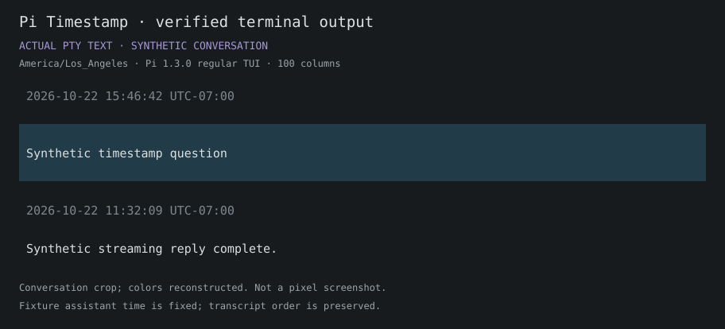
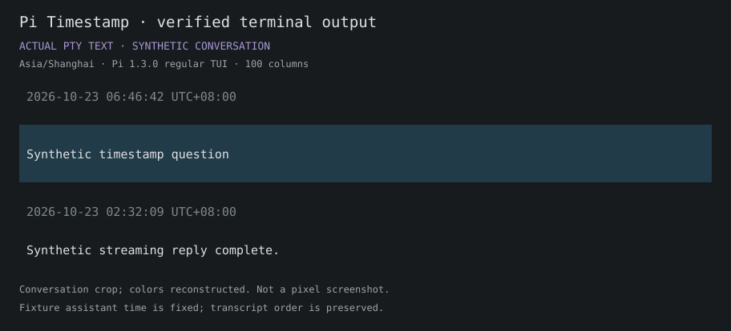

# Pi Timestamp

在每条 **user message 和 assistant response 上方**显示时间。支持本地主机时区、指定 IANA 时区及三种显示格式。基于 Pi 扩展 API，时间只保存为显示元数据，不进入模型提示词，也不修改 Pi。

默认格式为 `YYYY-MM-DD HH:mm:ss UTC±HH:mm`，默认时区为运行 Pi 的主机本地时区。实现已在 **Pi 1.3.0 / Node 22.23.1** 的隔离终端中验证。

## 实际终端示意图

以下 SVG 从实际 Pi regular TUI 的 PTY 屏幕文字记录生成，只截取对话行，保留原时间与行距，按 Pi dark 色值重绘。全部对话为合成数据，**不是像素截图**。测试 provider 固定 assistant 时间以便验证重放，所以不能把图中的时间差当成回复耗时。

主机本地时区（本次测试为 `America/Los_Angeles`）：



恢复同一磁盘会话，并使用 `Asia/Shanghai` 显示相同的消息时间：



## 使用

安装整个仓库中的扩展：

```sh
pi install git:github.com/co1smos/pi-extension
```

或安装本地 Timestamp 目录：

```sh
pi install /absolute/path/to/pi-extension/timestamp
```

在已打开的 Pi 中输入 `/reload`。若只想临时尝试，从仓库根目录启动：

```sh
pi -e ./timestamp/index.ts
```

不需要构建步骤或新增日期依赖。安装写入 Pi 的包配置，本地目录直接从原路径加载。

输入 `/timestamp` 打开配置菜单，也可直接使用：

```text
/timestamp timezone local
/timestamp timezone UTC
/timestamp timezone Asia/Shanghai
/timestamp format datetime24
/timestamp format time24
/timestamp format datetime12
/timestamp off
/timestamp on
```

| 格式 | 示例 |
|---|---|
| `datetime24`（默认） | `2026-10-22 11:32:05 UTC-07:00` |
| `time24` | `11:32:05 UTC-07:00` |
| `datetime12` | `2026-10-22 11:32:05 AM UTC-07:00` |

配置保存在 `getAgentDir()/timestamp.json`，通常为 `~/.pi/agent/timestamp.json`；使用 `PI_CODING_AGENT_DIR` 时跟随该目录：

```json
{
  "enabled": true,
  "timeZone": "local",
  "format": "datetime24"
}
```

有效配置以原子替换方式保存。命令保存后调用 Pi 的 reload，让可见的既有时间行按新格式/时区重绘；需要等待当前回复结束再修改。取消菜单不保存。无效输入保留原配置；损坏的配置文件保留原文件、提示一次并使用默认值。

## 时间与范围

- 使用原有 `message.timestamp`，不以重绘时间替代；它是消息记录时间，不等于首 token 或完成时间。排队 user 进入 transcript 后才出现时间行，保留 Pi 已记录的入队时间。
- 一条 user/assistant 消息记录一个时间条目。thinking 和多个文本块共用该行；流式更新不重复追加。没有参考实现的两秒去重，所以相邻消息不会按时间窗口合并。
- 时间通过 `message_start`、`appendEntry`、`registerEntryRenderer` 显示，正文仍由 Pi 渲染。toolResult、系统通知、摘要不另加时间；仅含工具调用的 assistant 仍属于 assistant 记录。
- `local` 是 Pi 主机时区；指定区域按消息发生时的 DST 规则换算。数字 UTC 偏移区分夏令时回拨的重复小时。原始 epoch 不变；缺失或无效时间显示 `Time unknown`。
- `off` 隐藏已有时间行并停止记录新条目；`on` 恢复显示已保存的条目，不补录关闭期间或启用前的消息。磁盘恢复和 reload 重用保存的条目。
- 首版面向交互 TUI；JSON/RPC/print 不新增时间条目。空内容/纯图片消息可能只显示时间行，布局由 Pi 决定。

## 验证与边界

已通过：3 项格式/配置单元测试；真实 regular TUI 中的流式上方显示、`/reload` 无重复、磁盘会话恢复、时区/格式重绘、开关、无效时区拒绝，以及原始 epoch/模型上下文不变。

尚未验证：fullscreen、tree/fork/compaction、排队/撤回、纯工具/空消息、错误/中止、不同终端宽度、复制/导出、非 TUI 行为和静态 TypeScript 类型检查。配置变更使用 Pi 完整 reload，也会触发其他已加载扩展的 reload 生命周期。

可复现检查（PTY 测试需已安装 `pi`、Python 3 和 Unix PTY，并使用全新的证据目录）：

```sh
node --test timestamp/test/settings.test.ts
python3 timestamp/test/terminal-smoke.py /absolute/path/to/fresh-proof-directory
```

[实现验证记录](validation.md) · [设计](design.md) · [设计决定](feedback-receipt.md) · [设计预览](review.html) · [早期源码研究](research-evidence.md)

## 来源

参考 [luongnv89/pi-extensions timestamp-pi](https://github.com/luongnv89/pi-extensions/tree/4db7ab6ca6ca7214c72c26fbca6bec64211bd379/extensions/timestamp-pi) 的 custom-entry 机制，改用 `message_start` 保证两类消息均在上方显示。本实现与图片独立编写，未加入相对时间、缓存倒计时或新的渲染框架。原作者 MIT 版权及许可见 [NOTICE.md](NOTICE.md)。早期 proposed 图和机制演示图继续保留，均有明确标签；上面的两张图来自实际 PTY 记录。

本项目采用 [MIT 许可](../LICENSE)。
